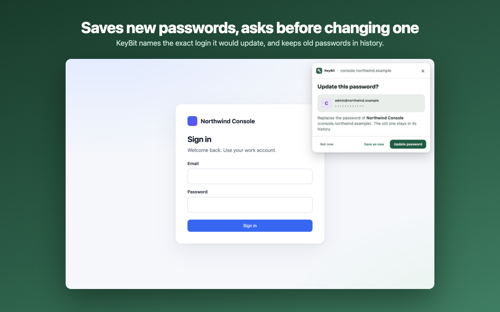
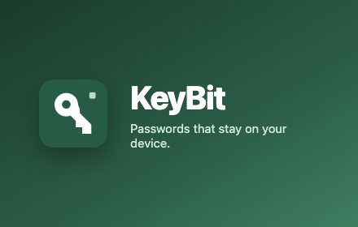

<h1 align="center">
  
</h1>

<h1 align="center">KeyBit</h1>

<p align="center">
  <i>Passwords that stay on your device — a private, local-only password manager for Chromium 🗝️</i>
</p>

<h4 align="center">
  <a href="#usage"></a>
  <a href="#development"></a>
  <a href="https://github.com/debugged-me/Keybit/releases"></a>
  <br>
  <a href="#security"></a>
  <a href="#development"></a>
  <a href="PRIVACY.md"></a>
</h4>

<p align="center">
    
</p>

## Introduction

KeyBit is a password manager that lives entirely in your browser. Logins, passkeys, 2FA codes, and secure notes are sealed with AES-256-GCM and never leave your device — no account, no cloud, no telemetry.

Click a sign-in field and your accounts appear in a dropdown bound to that exact origin. KeyBit works on every site by default, offers to save after you sign in, generates passwords, and backs itself up to a folder you choose.

Developers get first-class tools too: project environments with one-click switching, a command palette, per-site rules, and a form inspector — plus `localhost` project-folder matching so `localhost/shop` and `localhost/blog` never collide.

<details open>
<summary><strong>Features</strong></summary> <br />

<p align="center">
    
&nbsp;
    
</p>

<p align="center">
    
&nbsp;
    
</p>

<p align="center">
    
&nbsp;
    
</p>

<details>
<summary>🔑 <strong>Filling</strong> — on any site, including shadow DOM and cross-origin iframes</summary>

- The dropdown appears when you click a login field on any site, including a field that already has focus. It follows the field when the page scrolls.
- **Typing narrows the list**, and the account you used last comes first.
- **Two-step sign-ins:** on a username-only page, choosing the account fills it and continues to the password page, where the same account is listed first ("Continue").
- **2FA codes:** add a login's authenticator setup key — type it, paste the `otpauth://` link, or **Scan a QR image** (a screenshot of the site's setup QR, decoded entirely on-device). KeyBit then shows the 6-digit code in the login's details and in the dropdown on code fields, including six one-digit boxes.
- **Cards and IDs:** save a payment card or an ID (name, address, phone) in **Cards & IDs**. Focusing a card field or an address form shows the same dropdown — one click fills the number, expiry, CVV, or the whole address. Cards and IDs aren't site-bound; a masked number and cardholder name are all that ever leave the vault until you fill.
- **Lookalike-site warnings:** if a page's address only *resembles* a saved site — swapped letters, Cyrillic lookalikes, punycode, a one-letter typo — the dropdown leads with a warning instead of filling. Saved credentials never autofill on a different site; this adds the "wait, this isn't right" moment for the near-misses.
- **Sign-up and change-password fields** get a generated password in both fields.
- **Shadow DOM forms:** login fields inside *open* shadow roots — including nested roots and forms injected after page load — get the same detection, dropdown, and save prompts as ordinary fields. Closed shadow roots are never entered.
- **Cross-origin iframes:** a login form inside an iframe matches and fills against *the iframe's own origin*, never the parent page's. Each frame only ever receives credentials bound to its exact origin, and a frame that has navigated or been removed since you asked is refused.
- KeyBit is on for every site by default — there is nothing to switch on.

</details>

<details>
<summary>💾 <strong>Saving</strong> — offers after sign-in, never overwrites the wrong login</summary>

- KeyBit offers to save after you sign in. This works for normal forms, and for sites that sign in with a script button or the Enter key.
- **Same username, different site, never overwritten.**
  - Different domains, subdomains, ports, and http/https never match.
  - Local servers on the default port (XAMPP, MAMP, WAMP) treat each project folder as its own site. `localhost/shop` and `localhost/blog` stay apart.
- **The update card names the exact login it would change.** It offers Update, **Save as new**, or Not now. You pick when several logins share the username.
- **Each login keeps its last 5 passwords**, so a wrong update is easy to undo.

</details>

<details>
<summary>🛠️ <strong>Developer tools</strong> — palette, form inspector, environments, site rules</summary>

- **Command palette** (⇧⌘J / Ctrl+Shift+J): a keyboard-driven overlay on the page — search the vault, fill the matching login, generate a password, inspect the form, switch project environments, open KeyBit or the Security Center, create a note, lock. ↑↓ choose, Enter runs, Escape closes. While the vault is locked it shows only generic commands — never login names, project names, or anything else from the vault.
- **Login form inspector** (popup → site card, or the palette): reports how KeyBit sees the current page, frame by frame — which fields were found, their autocomplete hints, and common problems (missing `autocomplete`, `autocomplete="off"`, readonly/disabled fields, closed shadow roots, cross-origin frames). It lists structure only; typed values never appear.
- **Project environment switcher:** the popup offers environment chips under project logins that have more than one address. Switching keeps the current path, query, and fragment — `localhost/my-app/registrar?tab` becomes `myapp.example.com/registrar?tab` — and production chips are marked and ask for a second click before navigating (Settings can drop the confirmation). A project view's environment rows are editable; saved overrides merge with the addresses derived from the project's logins.
- **Site rules** (popup → ⚙ on the site card, or vault → Site rules): per-origin switches for what KeyBit offers — the site entirely, login suggestions, and save prompts — plus optional "include subdomains" widening. Turning a site off is now a rule, so customized sites appear together in Site rules; resetting a card restores the defaults. Rules are local preferences, not vault data.
- **Right-click menu:** on a link, **KeyBit → Preview with KeyBit**; on an editable field, **Fill with KeyBit**, **Generate password** (fills the field, and both fields on a sign-up form), and **Inspect login form**; on selected text, **Save as secure note** opens the vault's note editor with the text prefilled.

</details>

<details>
<summary>🔐 <strong>Passkeys & 2FA</strong> — stored in the vault, bound to their origin</summary>

- When a site offers to create a passkey, a KeyBit card asks to keep it in the vault. The private key is encrypted with everything else on this device — no account, no sync service.
- Signing in with a saved passkey shows a card naming the site and account. "Not now" or "Use device passkey" hands the call to the browser's built-in handling, as does anything KeyBit can't answer (a credential it doesn't hold, or a site mismatch).
- A passkey only answers the site that created it: KeyBit checks the calling page's origin against the credential's relying party before signing, and the page never sees the private key.
- Passkeys live in their own **Passkeys** sidebar section and in `.kvault` backups. They stay out of CSV export, password health, and the login dropdown — they are not passwords.

</details>

<details>
<summary>🗂️ <strong>Organising</strong> — projects, favourites, notes, Security Center, generator</summary>

- Every login has a site tile; a login can have up to 10 website addresses.
- **Favourites**, **secure notes**, and **projects**. A project's view groups its logins by environment: Production, Staging, Development, Local — and its **Environments** card lets you name the URL for each environment so the popup switcher can jump between them.
- Sort by name, recently used, or recently updated. Search covers logins and notes.
- **Security Center** scores the vault and shows its working — every factor lists its count and points, so "82%" reads as "−12 for two reused logins, +4 for two accounts with 2FA". Metric tiles count strong, weak, reused, duplicate, fresh/aging/old passwords, 2FA and passkey coverage, production logins, and what needs review. All of it is computed on this device; password age is flagged as a prompt to review, not a verdict.
- **Recently deleted** keeps deleted logins and notes for 30 days, then removes them forever. Restore them or empty the bin sooner.
- **Generator:** random (length and character groups) or memorable ("Acorn-Tulip-Rugby-Mango-Spoon7", from the EFF word list). Your choice is remembered for every Generate button and for sign-up fields.
- **Copied passwords and 2FA codes clear themselves from the clipboard after 30 seconds**, if you allow the optional clipboard-read permission. The timer runs in the background, so it works even if you close the popup right after copying — and it only clears when the clipboard still holds what KeyBit copied, so it never erases something else you copied since.

</details>

<details>
<summary>🪟 <strong>The app window</strong> — sidebar, dialogs, popup, auto-lock, themes</summary>

- **Sidebar:** All logins, Favorites, Secure notes, Cards & IDs, Passkeys, Recently deleted, Projects, Security Center, Generator, Import, Backup, and Settings. **Site rules** appears only while a site is customized. A **vault health** card at the bottom shows the Security Center score; click it to open the dashboard.
- **Keyboard:** ⌘K (Ctrl+K on Windows) jumps to search; / does the same when you're not typing.
- **Adding and editing happen in a dialog**, in the app and in the popup:
  - typing `example.com` is enough; KeyBit adds the http/https part;
  - a preview shows where the login will fill;
  - generate and show/hide sit inside the password field, with a strength meter;
  - you're warned about a duplicate username on the same site;
  - you're asked before unsaved typing is discarded.
- **Auto-lock** is the timer icon in the header (hover shows "Auto-lock: Never"). The vault stays unlocked while the browser runs — and by default across browser restarts too (Settings → **Stay unlocked across restarts**); only locking it yourself or an auto-lock timer you set will lock it.
- **Settings:**
  - lock when the computer locks or sleeps (off by default);
  - Touch ID or Windows Hello unlock;
  - change master password;
  - theme: System, Light, or Dark;
  - keyboard shortcuts;
  - whether switching to a production environment asks first.
- **Popup:**
  - shows this site's logins first, and searches all of them;
  - Fill, copy, and 2FA-code buttons;
  - a quick generator, and one-click fill for the current site;
  - / searches, ↑↓ move, Enter fills.
- **Notices** appear at the top centre.

</details>

<details>
<summary>📦 <strong>Import, backups & recovery</strong> — encrypted exports, a portable vault, Shamir sharing</summary>

- **Import** from Chrome, Helium, Edge, Apple Passwords, 1Password, LastPass, Dashlane, and others (CSV), or Bitwarden (CSV or unencrypted JSON).
  - A preview shows what will be added. Duplicates are skipped.
  - An entry without a website is kept as a secure note, not dropped.
- **Encrypted `.kvault` backups:**
  - **Export** downloads a copy.
  - **Automatic backup** writes a fresh encrypted copy to a folder you choose (for example iCloud Drive or Dropbox) after every change.
  - **Restore** can **merge** (adds logins, newer copies win, nothing deleted) or **replace** the vault.
  - A reminder appears when there's no backup from the last 30 days.
- **Portable vault** (Backup → Portable vault): a `.kvault` backup as a single HTML file that opens in any browser — no KeyBit install needed. It contains only the encrypted data; type the master password and it decrypts locally, right in the file. For a lost laptop or an emergency, this is the vault that survives everything.
- **Plain-text CSV export** for moving to another password manager. It is not encrypted, so KeyBit asks before exporting — delete the file when the move is done.
- **Share one item** from its details with **Share…**: a `.kvault` file encrypted with a passphrase you choose for it, with no server involved. Send it any way you like — AirDrop, a message, a USB stick. The recipient merges it into their KeyBit vault like a backup. Anyone holding both the file and the passphrase can read the item; choose a different passphrase than your master password.
- **Recovery kit** (Settings → Recovery kit) splits vault recovery across people you trust — no account, no escrow service:
  - Creating a kit seals an encrypted copy of the vault into `keybit-recovery.kvault` and splits its passphrase into *N* shares (Shamir's scheme, over GF(256)). You pick the threshold: any *M* shares rebuild it; *M−1* shares reveal nothing at all.
  - Keep the file and the shares in different places — for example the file on a USB stick and the shares with family. A share alone, or even the file alone, opens nothing.
  - To recover, the locked screen's **Recover with shares** takes the file plus enough pasted shares, then asks for a new master password.
  - The kit is a snapshot of the vault **as it was when created** — make a fresh kit after big changes, and if a share is ever lost.
  - KeyBit never receives, stores, or transmits shares or kits — splitting and rebuilding happen entirely on your device.
- **No practical limit on logins.** A vault can hold up to 32 MB of login data, about 100,000 typical logins.

**Keeping your logins:**

- **Restarting the browser or the computer keeps everything** — the vault is saved on disk in your browser profile, encrypted.
- With **Stay unlocked across restarts** on (the default), the vault reopens by itself. Turn it off on a shared machine: the key then lives in memory only and quitting locks the vault.
- **Removing KeyBit from the browser deletes its vault** — this is how Chromium handles extension storage. Keep a backup; automatic folder backup does this for you.
- **A copy of KeyBit installed another way starts empty** — a moved folder or the Web Store version is a different extension. Restore or merge your backup there.

Without a backup or recovery kit, forgotten master passwords cannot be recovered.

</details>

<details>
<summary>⚡ <strong>Performance</strong> — measured on a 20,000-login vault</summary>

| | Before | Now |
| --- | --- | --- |
| Vault status check (pages poll this) | ~23 ms | 0.3 ms |
| Matching logins for a page | ~50 ms | ~7 ms |
| Dropdown appearing after a click | ~440 ms | ~40 ms |
| KeyBit woken by ordinary page loads | Yes | No |

What changed:

- **Cached checks:** status no longer reads the whole vault from storage, and saved addresses are parsed once.
- **Quiet pages:** pages no longer ask KeyBit about pending save prompts on every load; KeyBit tells the one tab that needs it instead.
- **Less background work:** the dropdown and pages poll less often; the word list loads only when a memorable password is made; field detection only scans the field types that can match.

</details>

</details>

## Usage

KeyBit runs as a developer-mode unpacked extension — no store account needed:

1. Download or clone this repository.
2. Open `chrome://extensions` and enable **Developer mode**.
3. Click **Load unpacked** and select this folder (the one containing `manifest.json`).
4. Pin KeyBit (puzzle icon → pin), then create your vault — a welcome page walks you through it.
5. Visit any sign-in page and click a login field. Pick an account from the **KeyBit** dropdown — or press ↓ then Enter — and it fills.

> **Note**
> **Don't move or rename the folder afterwards.** Chromium identifies an unpacked extension by its path — a moved copy is a *different* extension with an empty vault. Export a backup first if you need to relocate it.

<details>
<summary>Keyboard shortcuts</summary> <br />

| Shortcut | Action |
| --- | --- |
| ⇧⌘K (Ctrl+Shift+K) | Open the popup |
| ⌥⇧L (Alt+Shift+L) | Open the dropdown on the page's login field |
| ⇧⌘J (Ctrl+Shift+J) | Open the command palette on the page |

Rebind them at `chrome://extensions/shortcuts`. In the app window: ⌘K or / jumps to search, ↑↓ move, Enter fills.

</details>

<details>
<summary>Updating to a new version</summary> <br />

Pull the repo, then press **Reload** on KeyBit's card at `chrome://extensions`. Open tabs pick up the new version automatically. If you update the folder but forget to reload, KeyBit's pages show **Finish updating KeyBit** with a **Reload KeyBit** button.

If another password dropdown covers KeyBit's, disable **iCloud Passwords** (or the browser's built-in manager) at `chrome://extensions`, and turn off **Offer to save passwords** in the browser's password settings.

</details>

## Security

- **AES-256-GCM**, key derived by PBKDF2-HMAC-SHA-256 with 600,000 iterations — everything in the vault is encrypted, and the master password is never stored.
- **Exact-origin matching** — scheme, host, port, plus project folder on localhost. Filling is always your choice; KeyBit never submits forms.
- **Isolation** — the dropdown, save card, and palette are extension frames in a closed shadow root; page scripts never see the account list.
- **No network** — the content security policy allows bundled code only and blocks connections outright.

A personal project, not an independently audited password manager. See [PRIVACY.md](PRIVACY.md).

<details>
<summary>The full security model</summary> <br />

- **Encryption:** Web Crypto derives a non-extractable AES-256 key using PBKDF2-HMAC-SHA-256 with 600,000 iterations and a fresh 16-byte salt. Every encryption uses a fresh 12-byte IV. The envelope header is authenticated. Decoding runs in linear time on large vaults. See [OWASP's PBKDF2 guidance](https://cheatsheetseries.owasp.org/cheatsheets/Password_Storage_Cheat_Sheet.html).
- **What is encrypted:** everything inside the vault, including notes, 2FA secrets, password history, projects, and favourites.
- **What `chrome.storage.local` also holds:**
  - the unlocked vault key while **Stay unlocked across restarts** is on — the one sensitive entry, since anything that can read this browser profile's storage can then open the vault;
  - per-site rules (origins and on/off switches — no credentials);
  - last-used times keyed by random login IDs;
  - generator and theme choices;
  - backup timestamps;
  - the Touch ID record.

  The automatic-backup folder handle lives in IndexedDB.
- **The master password** is never stored. While unlocked, the key lives in the background worker's memory and — with **Stay unlocked across restarts** on — in extension storage.
- **Locking happens:**
  - when the auto-lock time passes;
  - when you click Lock;
  - **when the computer's screen locks or it sleeps** (off by default; Settings can turn it on);
  - when the browser quits, but only while Stay unlocked is off.

  While unlocked, a tiny keep-alive stops Chromium suspending the worker early.
- **Touch ID / Windows Hello:**
  - Turning it on creates a passkey for KeyBit.
  - Its PRF output, released only after the fingerprint or face check, seals the vault key.
  - Changing the master password or replacing the vault turns it off.
  - The master password is never stored.
- **Matching and filling:**
  - Scheme, exact host, and port must match, plus the project folder on local servers.
  - Filling is always your choice. The worker rechecks the page and targets the original document.
  - KeyBit never submits forms.
- **Isolation:** the dropdown, save card, and command palette are extension frames in a closed shadow root. The page's scripts never receive the account list or secrets. Generated passwords and 2FA codes reach the page only when you choose them. While locked, the palette's command list is built without touching vault data — no login or project names can leak into it.
- **Frames:** in iframes, each frame's dropdown is bound to that frame's own origin and document. Credentials are matched and sent only to the one frame whose address matches the login, and stale frames (navigated or removed mid-interaction) fail closed.
- **Site rules:** the per-site switches live outside the vault as origins plus on/off flags — no secrets. They gate suggestions, save prompts, and palette actions the same way everywhere.
- **Save prompts:**
  - Submitted values are read only on a trusted submit, click, or Enter, and held in memory for at most two minutes.
  - Updates always use the login you confirmed.
  - A change-password form can only update a login for that exact site or project folder.
- **Content Security Policy:** bundled code only, with network connections blocked. Icons are fixed inline SVG, and user data is never rendered as HTML.

</details>

## Permissions

| Permission | Why KeyBit needs it |
| --- | --- |
| HTTP/HTTPS host access (all sites) | Show the dropdown in login fields and offer to save passwords on any website. |
| `scripting` | Fill the chosen login, and add KeyBit to tabs already open at install. |
| `storage` | Save the encrypted vault on this device. |
| `unlimitedStorage` | Keep large vaults from hitting the storage quota. |
| `idle` | Lock when the computer's screen locks. |
| `activeTab` | Let the popup work on the current tab if you restrict KeyBit's site access. |
| `clipboardWrite` | Copy a username, password, or code when you click Copy. |
| `clipboardRead` (optional) | Clear a copied password or code from the clipboard after 30 seconds. Only asked the first time you copy a secret. |
| `contextMenus` | Right-click entries: fill or generate on a field, inspect a form, save a selection as a note. |

No history, cookies, downloads, webRequest, tabs, or management permission.

## Limitations

- **Chromium only** — Firefox and Safari don't expose the per-document binding (`documentId`) KeyBit uses to keep the dropdown safe.
- A few pages resist automation: closed shadow roots (sealed by design), login iframes on pages that block extension content scripts, and browser-internal pages.
- No cloud sync and no automatic form submission — by design.

## Development

Prerequisite: **Node.js 22+** for linting and type-checking. The extension itself has no build step and zero dependencies.

<details open>
<summary>Running the checks</summary> <br />

```sh
npm install            # dev tooling only — the extension ships zero dependencies
npm run check          # eslint + typecheck
npm run package        # build keybit.zip (manifest + icons + src)
npm run store:assets   # regenerate the store screenshots in store/assets/
```

</details>

Cut a release with `npm run release -- 1.4.0` — it bumps the version everywhere, runs the checks, and builds the store zip. Listing text and permission justifications live in [store/listing.md](store/listing.md); host [PRIVACY.md](PRIVACY.md) as the privacy policy.

<details>
<summary>Source layout</summary> <br />

```text
manifest.json          Registration, permissions, shortcuts, CSP
icons/                 Logo and PNG icons
src/
  background/          Messages, keep-alive, screen-lock lock, site rules, dropdown modes, save prompts, passkey ceremonies, last-used order, folder backups, palette tokens
  crypto/              Encoding, PBKDF2, AES-GCM, backup parsing, Touch ID key sealing
  vault/               Schema (logins, notes, passkeys, history, 2FA, project environments), storage, CRUD, import, merge, single-item shares, Shamir recovery kits, password change, security report, TOTP, WebAuthn encoding and ECDSA signing
  matching/            Exact-origin matching with project folders, cached
  generator/           Secure random and memorable passwords, remembered preferences, EFF word list
  import/              CSV and Bitwarden JSON parsers
  content/             Login, sign-up, username-step and 2FA field detection incl. open shadow roots; per-frame filling; submit, click and Enter capture; WebAuthn interception and passkey relay
  inline/              Dropdown (accounts, generated password, 2FA codes), save/update card, and passkey consent card
  developer/           Login form inspector page and per-frame form analysis
  command/             Command palette overlay, fuzzy search, and the command registry
  rules/               Per-site rule model (enabled / logins / save / generate / 2FA / cards, subdomain widening)
  ui/                  Shared styles and themes, tiles, icons, session client, sign-in and Touch ID, login dialog
  popup/               Current site, search, fill/copy/2FA, generator, keyboard use
  vault-ui/            App window: lists, projects and environment maps, details, Security Center, site rules, import, backup, settings
store/                 Listing text, templates, and generated store images
scripts/               release.mjs, store-assets.mjs, and the CDP browser harness
```

</details>

## Resources

- **[Privacy policy](PRIVACY.md)** — what's stored, what's encrypted, and the one sensitive storage entry.
- **[Store listing](store/listing.md)** — description, permission justifications, and privacy answers.
- **[Issues](https://github.com/debugged-me/Keybit/issues)** — bug reports and feature requests.
- **[Icon source](icons/keybit.svg)** — the logo as a vector.

## Contributing

Issues and pull requests are welcome. If you hit a page KeyBit can't fill, a bug report with the form inspector's output (popup → site card → inspect) is the fastest way to get it fixed — it lists structure only, never typed values.
