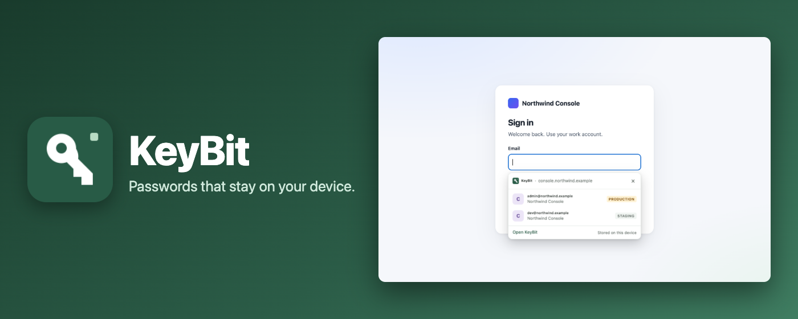
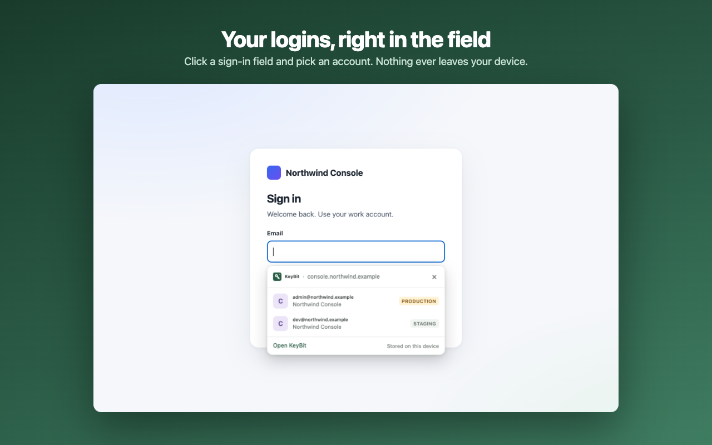
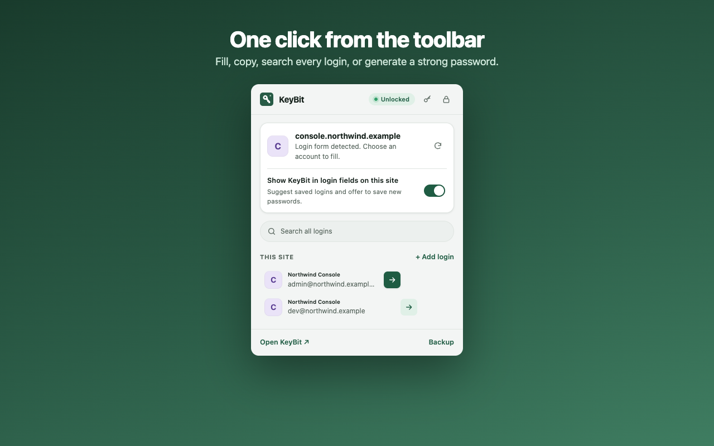
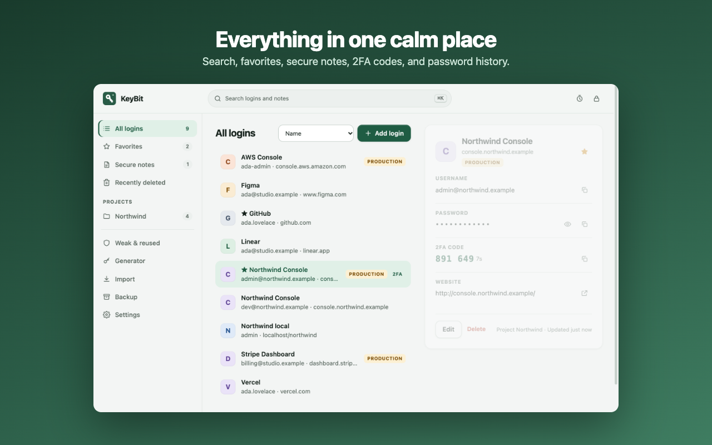
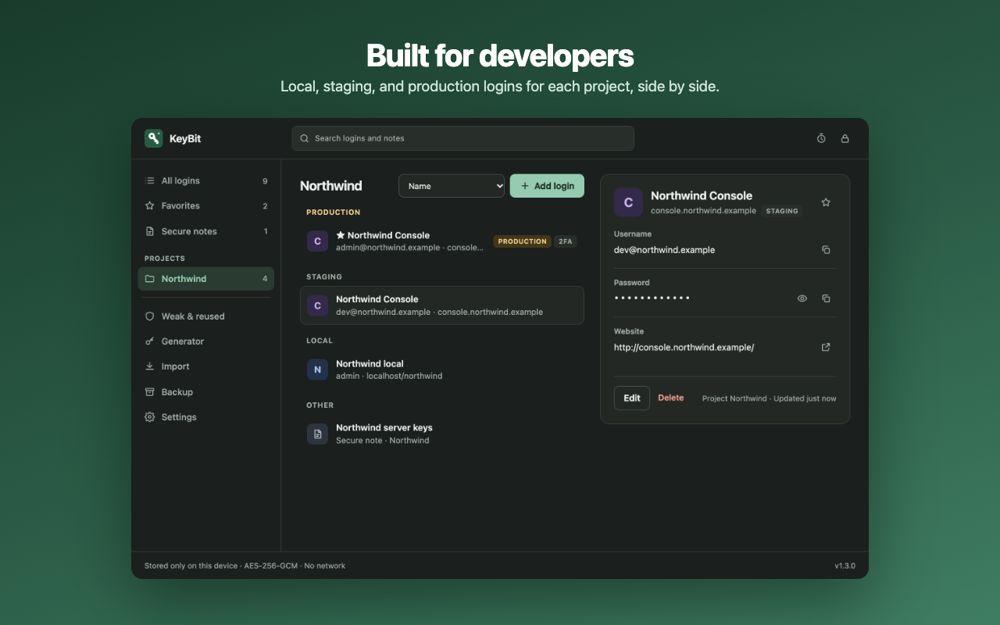

<p align="center"></p>

<h1 align="center">KeyBit</h1>

<p align="center"><strong>Passwords that stay on your device.</strong></p>

<p align="center">
  A private, local-only password manager for Chromium browsers.<br>
  Click a sign-in field, pick an account — nothing ever leaves your machine.
</p>

<p align="center">
  
  
  
  
  
</p>

<p align="center">
  <a href="#install"><strong>Install</strong></a>
  · <a href="#what-you-get">Tour the features</a>
  · <a href="https://github.com/debugged-me/Keybit/issues">Report a bug</a>
</p>

> **Chromium 127+ · Helium, Chrome & Edge · Manifest V3.** Runs as a
> developer-mode **unpacked extension** — no store account needed. The vault
> is encrypted storage inside the browser profile; removing the extension
> deletes it, so set up [backups](#backups-and-recovery) early.

[Install](#install) | [What you get](#what-you-get) | [Backups](#backups-and-recovery) | [Security](#security) | [Build](#build-from-source)

<p align="center">
  
</p>

## Why

Browser password managers sync your logins to an account you don't control.
KeyBit is a full vault — AES-256-GCM encrypted, opened by a master password or
Touch ID — that lives entirely inside the extension. No backend, no account,
no build step, no runtime dependencies, no telemetry: its content security
policy blocks network connections outright.

## Install

1. Download or clone this repository.
2. Open `chrome://extensions` and enable **Developer mode**.
3. Click **Load unpacked** and select this folder (the one containing `manifest.json`).
4. Pin KeyBit (puzzle icon → pin), then create your vault — a welcome page walks you through it.
5. Visit any sign-in page and click a login field. Pick an account from the **KeyBit** dropdown — or press ↓ then Enter — and it fills.

**Shortcuts:** ⇧⌘K opens the popup · ⌥⇧L opens the in-page dropdown · ⇧⌘J opens the command palette (Ctrl/Alt instead of ⌘ on Windows). Rebind at `chrome://extensions/shortcuts`.

> **Don't move or rename the folder afterwards.** Chromium identifies an
> unpacked extension by its path — a moved copy is a *different* extension
> with an empty vault. Export a backup first if you need to relocate it.

To update: pull the repo, then press **Reload** on KeyBit's card at `chrome://extensions`. Open tabs pick up the new version automatically.

## What you get

<p align="center">
  
  
</p>
<p align="center">
  
  
</p>

- 🔑 **Fills anywhere** — usernames, passwords, 2FA codes, cards and addresses, sign-up forms, open shadow roots, and cross-origin iframes (each matched to the *iframe's* own origin).
- 💾 **Saves without clobbering** — offers to save after sign-in, names the exact login before updating, and keeps each login's last 5 passwords. Same username on two sites never collides — `localhost/shop` and `localhost/blog` stay apart too.
- 🛡️ **Warns on lookalikes** — swapped letters, Cyrillic confusables, punycode and one-letter typos get a warning instead of a fill.
- 🔐 **Passkeys & 2FA** — store passkeys and authenticator keys in the vault (paste the `otpauth://` link or scan a QR screenshot); the code sits right in the dropdown on code fields.
- 🗂️ **Built for projects** — group logins with local / staging / production environments, and switch between them with one click — path and query preserved.
- 🪟 **One calm app window** — favourites, secure notes, cards & IDs, recently deleted, a generator (random or memorable words), and a Security Center that explains its score.
- 🛠️ **Developer tools** — command palette (⇧⌘J), login form inspector, per-site rules, and a right-click menu for fill / generate / inspect / save-as-note.
- 🔒 **Locks when you say so** — auto-lock timer, lock on sleep, Touch ID or Windows Hello unlock — or stay unlocked across restarts.

## Backups and recovery

- **Encrypted `.kvault` export** — one click downloads a copy; restoring can **merge** (newer wins, nothing deleted) or **replace**.
- **Automatic folder backup** — point KeyBit at iCloud Drive, Dropbox, or any folder; a fresh encrypted copy lands after every change.
- **Portable vault** — a `.kvault` wrapped in a single HTML file that opens in any browser: type the master password, it decrypts right in the file. The vault that survives a lost laptop.
- **Share one item** — export a single login or note encrypted with its own passphrase; send it by AirDrop, message, or USB stick.
- **Recovery kit** — split the vault passphrase into *N* shares (Shamir, GF(256)); any *M* rebuild it, *M−1* reveal nothing. All on-device.
- **Import** — Chrome, Helium, Edge, Apple Passwords, 1Password, LastPass, Dashlane, Bitwarden (CSV/JSON), with a preview before anything lands. Plain-CSV export exists too — KeyBit warns first; delete the file when you're done.

Without a backup or kit, a forgotten master password cannot be recovered.

## Security

- **Encryption:** PBKDF2-HMAC-SHA-256 (600,000 iterations) → a non-extractable AES-256-GCM key; fresh salt and IV per encryption. Everything in the vault is encrypted — notes, 2FA secrets, passkeys, password history. The master password is never stored.
- **Matching is exact** — scheme, host, and port (plus project folder on localhost). Filling is always your choice, and KeyBit never submits forms.
- **Isolation:** the dropdown, save card and palette are extension frames in a closed shadow root — page scripts never see the account list. While locked, the palette can't even read vault data.
- **CSP:** bundled code only, network connections blocked. No telemetry, no accounts, no sync — verify by watching the network panel if you like.
- **Locking:** auto-lock timer, manual lock, lock on screen-lock/sleep (optional), or on browser quit (when "stay unlocked" is off).

A personal project with automated checks, not an independently audited password manager. See [PRIVACY.md](PRIVACY.md).

## Permissions

| Permission | Why KeyBit needs it |
| --- | --- |
| HTTP/HTTPS host access (all sites) | Show the dropdown in login fields and offer to save passwords on any website. |
| `scripting` | Fill the chosen login, and add KeyBit to tabs already open at install. |
| `storage` | Save the encrypted vault on this device. |
| `unlimitedStorage` | Keep large vaults from hitting the storage quota. |
| `idle` | Lock when the computer's screen locks. |
| `activeTab` | Let the popup work on the current tab if you restrict KeyBit's site access. |
| `clipboardWrite` | Copy a username, password, or code when you click Copy. |
| `clipboardRead` (optional) | Clear a copied password or code from the clipboard after 30 seconds. Only asked the first time you copy a secret. |
| `contextMenus` | Right-click entries: fill or generate on a field, inspect a form, save a selection as a note. |

No history, cookies, downloads, webRequest, tabs, or management permission.

## Light by design

On a 20,000-login vault:

| | Before | Now |
| --- | --- | --- |
| Vault status check | ~23 ms | 0.3 ms |
| Matching logins for a page | ~50 ms | ~7 ms |
| Dropdown appearing after a click | ~440 ms | ~40 ms |
| KeyBit woken by ordinary page loads | Yes | No |

## Limitations

- **Chromium only** — Firefox and Safari don't expose the per-document binding KeyBit uses to keep the dropdown safe.
- A few pages resist automation: closed shadow roots, login frames on extension-blocked pages, and browser-internal pages.
- No cloud sync and no automatic form submission — by design.

## Build from source

```sh
npm install            # dev tooling only — the extension itself ships zero dependencies
npm run check          # eslint + typecheck
npm run package        # build keybit.zip (manifest + icons + src)
npm run store:assets   # regenerate the store screenshots in store/assets/
```

Cut a release with `npm run release -- 1.4.0` — bumps the version everywhere, runs the checks, and zips the store package. Listing text and permission justifications live in [store/listing.md](store/listing.md).
